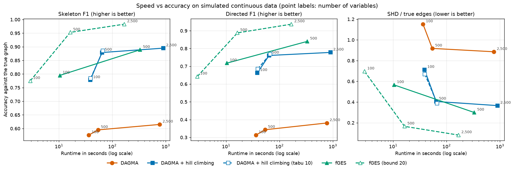

# Causal discovery starter

Learn a causal graph from a large table (thousands of columns, ~100,000 rows) with three methods, and compare them
on held-out rows.

| Method | What it is | Needs |
|---|---|---|
| `dagma` | **DAGMA** (Bello et al., NeurIPS 2022), the way it is usually run: linear model, library defaults | Python; a GPU strongly recommended above ~500 columns |
| `dagma_hc` | **DAGMA + BIC hill climbing**: DAGMA (plus partial correlations) proposes likely neighbours for each column, then a greedy search scored by the BIC decides which edges to keep and their direction | Python (+ GPU for the DAGMA part) |
| `fges` | **fGES** (Fast Greedy Equivalence Search) from CMU's Tetrad, the score-based method with the strongest published evidence of scaling to thousands of variables | Java 21+ and the `py-tetrad` package |

**On simulated data at the target size** (2,500 variables, 100,000 rows), fGES recovered the true graph's connections with F1 0.98 in under 3 minutes. DAGMA + hill climbing reached 0.90 in 15 minutes, and DAGMA alone 0.62. Section 4 has the details, and explains the metrics.

---

## 1. Causal discovery in five minutes

**The output is a graph.**
- Each column of your table is a variable, and the output is a directed graph over them.
- An arrow `A -> B` means "A directly influences B, with the other variables held fixed".
- The graph is a **DAG** (directed acyclic graph): following arrows never brings you back to where you started.

**The input is just your rows.** There are no experiments or interventions. The methods use the pattern of
(conditional) dependences in the data. If A and C are dependent but become independent once you know B, that
suggests a chain or fork through B. If A and C are independent but both depend on B, that suggests `A -> B <- C`.

**What these methods assume.** Read these before trusting any arrow:
1. **No hidden common causes.** If something unmeasured drives two columns, the methods may draw an edge between
   them that isn't causal.
2. **No feedback loops,** because the output is acyclic.
3. **Rows are independent draws from one process.** Time series break this (see section 6).
4. **Relationships are roughly linear** for continuous data: all three methods here use linear models. Strong
   nonlinearity can hide edges or create spurious ones.

**Directions are only partly identifiable.**
- From observational data alone, some arrows cannot be oriented. `A -> B` and `B -> A` explain the data equally
  well unless a third variable breaks the tie, such as `A -> B <- C`.
- fGES reports which edges it could orient; the other two methods pick a direction anyway.
- Treat directions as the weakest part of the result.

**The output is a set of hypotheses, not facts.** Use it to prioritize: which relationships to check with domain
experts, and which experiments to run.

## 2. Install

You need Python 3.12+, and for `fges`, Java 21+.

```bash
git clone <this repo> && cd causal-discovery-starter
python3.12 -m venv .venv && source .venv/bin/activate
```

**1. PyTorch.** Install a build that matches your GPU driver. Run `nvidia-smi`; the driver version is in the top
line. The CUDA 12.8 build works with drivers 525 and newer, including the 550 series:

```bash
pip install torch --index-url https://download.pytorch.org/whl/cu128   # NVIDIA GPU
# pip install torch --index-url https://download.pytorch.org/whl/cpu   # no GPU
```

**2. This package**, with fGES support:

```bash
pip install -e ".[fges,dev]"
```

**3. Java,** for `fges` only. Check with `java -version` (21 or newer). To install it:
- Ubuntu: `sudo apt install openjdk-21-jdk`
- macOS: `brew install openjdk@21`
- No admin rights: `conda install -c conda-forge openjdk=21`

**4. Check everything works,** in about a minute on a CPU:

```bash
python -m pytest -q
```

## 3. Quick start on simulated data, with a known answer

```bash
# 100 variables, 20,000 rows, a random true graph (written to data/sim_truth.csv)
python -m causal_discovery simulate --nodes 100 --samples 20000 --out data/sim.csv

# learn graphs on 80% of the rows, score them on the other 20%, and compare with the true graph
python -m causal_discovery benchmark --data data/sim.csv --truth data/sim_truth.csv --out results/sim
```

The table is printed and saved in `results/sim/results.md`. Each method's graph is saved as
`results/sim/graph_<method>.csv`, one `source,target` row per edge. Sections 4 and 5 explain the columns.

## 4. Results on simulated data

We ran the benchmark on simulated data, where the true graph is known, to show how accurate and how fast each method
is. The script `benchmarks/run_simulated.sh` reproduces everything below; `benchmarks/summarize.py` rebuilds the
tables and the figure.

**What was simulated** (`causal_discovery/simulate.py`):
- **Continuous data:**
  - A random DAG with about 2 edges per variable.
  - Every variable is a linear combination of its parents, with weights between ±0.5 and ±2, plus Gaussian noise.
  - All columns are standardized before learning, so no method can exploit differences in scale.
- **Categorical data:** the same kind of graph, with 2–4 categories per variable and random probability tables.

**How it was run:**
- A random 20% of rows was held out; every method learned on the other 80%.
- fGES ran both unbounded and bounded (`--fges-bound 20`) where both were feasible; at 2,500 variables only bounded.
- Hardware: one NVIDIA RTX 4090 for DAGMA, and 16 CPU cores for hill climbing and fGES.
- Settings: defaults throughout (`--penalty 1`, 5 restarts, `k = 20`). The "(tabu 10)" row is the same as the row
  above it except for `--tabu 10`.

### What the accuracy metrics mean

Skeleton F1, directed F1 and SHD compare the learned graph with the true one, so they exist only for simulated data.
Held-out gain needs no true graph, so it is the one you can use on real data.

| Metric | What it measures | Best value |
|---|---|---|
| **Time (s)** | Wall-clock time to learn the graph from the training rows. For DAGMA + hill climbing it includes the DAGMA fit | lower |
| **Edges** | Number of arrows found. Compare it with the true number in each table's heading | close to the truth |
| **Skeleton F1** | Ignores arrow directions and asks whether the right pairs are connected. *Precision* is the share of found connections that are real; *recall* is the share of real connections found; F1 = 2·precision·recall / (precision + recall) balances the two | 1 |
| **Directed F1** | The same, but an arrow counts only if it also points the right way. Even a perfect method cannot always reach 1, because some directions cannot be determined from observational data (section 1) | 1 |
| **SHD** (structural Hamming distance) | The number of single-edge corrections that turn the learned graph into the true one: add a missing edge, delete an extra one, or flip a reversed one | 0 |
| **Held-out gain / row** | How much better the learned graph predicts the 20% test rows than the empty graph does (every variable independent). It is the log-likelihood per test row, summed over all variables, minus the empty graph's. Higher is better. It rewards finding real dependences, barely penalizes extra edges, and ignores directions | higher |

### Speed vs accuracy



Each line is one method. Its points are the 100-, 500- and 2,500-variable datasets (labelled), placed by runtime
(horizontal, log scale) and accuracy (vertical).

**Continuous, 100 variables, 20,000 rows** (true graph: 191 edges)

| Method                          |   Time (s) |   Edges |   Skeleton F1 |   Directed F1 |   SHD |   Held-out gain / row |
|:--------------------------------|-----------:|--------:|--------------:|--------------:|------:|----------------------:|
| DAGMA                           |         36 |     205 |          0.58 |          0.31 |   220 |                  84.7 |
| DAGMA + hill climbing           |         39 |     295 |          0.78 |          0.66 |   136 |                 105.8 |
| DAGMA + hill climbing (tabu 10) |         39 |     291 |          0.78 |          0.68 |   128 |                 105.8 |
| fGES                            |         10 |     252 |          0.8  |          0.72 |   108 |                 103   |
| fGES (bound 20)                 |          3 |     266 |          0.78 |          0.64 |   133 |                  99.1 |

**Continuous, 500 variables, 50,000 rows** (true graph: 987 edges)

| Method                          |   Time (s) |   Edges |   Skeleton F1 |   Directed F1 |   SHD |   Held-out gain / row |
|:--------------------------------|-----------:|--------:|--------------:|--------------:|------:|----------------------:|
| DAGMA                           |         54 |     720 |          0.6  |          0.34 |   906 |                 379.6 |
| DAGMA + hill climbing           |         64 |    1235 |          0.88 |          0.76 |   400 |                 600.6 |
| DAGMA + hill climbing (tabu 10) |         67 |    1220 |          0.88 |          0.77 |   383 |                 600.6 |
| fGES                            |        330 |    1189 |          0.89 |          0.84 |   295 |                 594.5 |
| fGES (bound 20)                 |         16 |    1064 |          0.95 |          0.89 |   163 |                 586.6 |

**Continuous, 2,500 variables, 100,000 rows** (true graph: 4956 edges)

| Method                |   Time (s) |   Edges |   Skeleton F1 |   Directed F1 |   SHD |   Held-out gain / row |
|:----------------------|-----------:|--------:|--------------:|--------------:|------:|----------------------:|
| DAGMA                 |        772 |    3779 |          0.62 |          0.38 |  4388 |                1861.7 |
| DAGMA + hill climbing |        901 |    6109 |          0.9  |          0.78 |  1812 |                2898.1 |
| fGES (bound 20)       |        167 |    5083 |          0.98 |          0.94 |   402 |                2880.8 |

**Categorical, 50 variables, 20,000 rows** (true graph: 90 edges)

| Method                |   Time (s) |   Edges |   Skeleton F1 |   Directed F1 |   SHD |   Held-out gain / row |
|:----------------------|-----------:|--------:|--------------:|--------------:|------:|----------------------:|
| DAGMA                 |         11 |      13 |          0.25 |          0.16 |    82 |                   2.5 |
| DAGMA + hill climbing |         12 |      92 |          0.97 |          0.84 |    18 |                  10.6 |

### What the results say

- **At the target size (2,500 variables, 100,000 rows), fGES is both the fastest and the most accurate.** Bounded
  to each variable's top 20 partial correlations, it found the true connections with skeleton F1 0.98 and directed
  F1 0.94 in under 3 minutes on 16 CPU cores.
  - DAGMA + hill climbing reached 0.90 and 0.78 in 15 minutes, most of it the DAGMA fit on the GPU.
  - DAGMA alone reached 0.62 and 0.38.
- **Unbounded fGES** was the most accurate method at 100 variables. It gets slow quickly as variables are added
  (10 s at 100, 330 s at 500), and at 2,500 it had not finished after 2.5 hours. The bounded version was faster and
  more accurate at 500 and 2,500 variables, but less accurate at 100. That is why fGES is bounded by default from
  500 variables up.
- **DAGMA on its own misses much of the structure,** mostly because of its fixed 0.3 weight cut-off. Its directions
  are also unreliable on standardized data.
- **DAGMA + hill climbing fixes most of that.** Its main weakness is extra edges (6,109 against 4,956 true at
  2,500 variables), because greedy hill climbing gets stuck and compensates for wrong directions with additional
  edges. Tabu search (`--tabu 10`) helped only slightly here.
- **Held-out likelihood cannot rank graphs that are both nearly right.** At 2,500 variables DAGMA + hill climbing
  scores slightly *higher* on held-out rows than fGES (2,898 against 2,881 per row), although fGES is far more
  accurate (SHD 402 against 1,812). Extra edges cost almost nothing in prediction with this many rows. On real data,
  use held-out likelihood to spot missing structure (DAGMA alone is far behind) and the edge counts and agreement
  between methods to judge the rest.
- **Categorical data:** DAGMA + hill climbing recovers the graph well (skeleton F1 0.97). fGES is not wired for
  categorical data in this package.
- **These are best-case numbers.** The simulations satisfy every assumption in section 1: linear relationships, no
  hidden variables, independent rows. Expect lower accuracy on real data.

**Runtime at 2,500 variables x 100,000 rows** (RTX 4090 + 16 cores; the whole benchmark took about 20 minutes,
including loading and scoring):

| Step | Time |
|---|---|
| DAGMA fit (GPU) | 13 minutes |
| Hill climbing (5 restarts, CPU) | 2 minutes |
| fGES, bounded (16 CPU cores, 64 GB Java heap) | 3 minutes |
| Memory | ran within a 128 GB allocation, 64 GB of it the Java heap for fGES (a 16 GB heap ran out of memory with unbounded fGES) |


## 5. Your data

**Format.**
- One row per sample and one column per variable, in `.csv`, `.parquet` (recommended at this size) or `.feather`.
- No missing values: impute or drop them first.
- Drop identifier and timestamp columns with `--drop-columns id timestamp`.
- Constant columns are rejected.

**Benchmark the three methods:**

```bash
# rows are independent samples: hold out a random 20%
python -m causal_discovery benchmark --data mydata.parquet --split random --out results/bench

# rows are in time order: train on the first 80%, test on the last 20%
python -m causal_discovery benchmark --data mydata.parquet --split last --out results/bench_time
```

**Learn the final graph** with your chosen method, on all rows:

```bash
python -m causal_discovery run --data mydata.parquet --method fges --out results/final
```

This writes `edges.csv`, `adjacency.npy` (`A[i, j] = 1` means column i -> column j) and `info.json`.

**Reading the benchmark table.**

| Column | Meaning |
|---|---|
| `edges` | Number of arrows |
| `heldout_loglik_per_row` | Each method fits a model to the training rows: every variable predicted from its parents (linear regression; a probability table for categorical data). This column is how probable the *test* rows are under that model, averaged over rows. Higher is better |
| `gain_vs_empty_per_row` | Improvement over the "empty graph" where every variable is independent, with a 95% interval (`gain_vs_empty_95ci`) |
| Method-vs-method table | Row-by-row difference between two methods, with a 95% interval. If the interval includes 0, the two fit equally well. `skeleton_jaccard` is the share of their connections, ignoring direction, that the two methods agree on |
| `skeleton_f1`, `directed_f1`, `shd` | Only with `--truth` (simulated data): accuracy of the connections, of the arrows, and the number of wrong edges |

**How to use it:**
- A graph that misses real dependences predicts worse, so a low score means missing structure.
- Extra edges barely hurt prediction with 80,000 training rows. When two methods are within each other's interval,
  prefer the sparser graph.
- Held-out likelihood cannot judge arrow directions: graphs that differ only in direction can score exactly the same.
- Agreement between methods (`skeleton_jaccard`) is a useful stability check. Edges found by all three are the most
  trustworthy.

## 6. Settings that matter

| Option | Default | When to change it |
|---|---|---|
| `--penalty` | 1 (standard BIC) | Applies to `dagma_hc` and `fges`. **With 100,000 rows, real data often give very dense graphs**, because BIC then accepts even tiny dependences. Raise it (2 to 10) for sparser graphs |
| `--min-partial-corr` | off | The same idea in interpretable units: only keep edges whose partial correlation is at least this, e.g. `0.03` or `0.05`. Overrides `--penalty` |
| `--k` | 20 | `dagma_hc`: candidate neighbours per variable from each source. More finds more true edges but runs slower |
| `--tabu` | 0 | `dagma_hc`: set to 10 for tabu search, which may take a few downhill moves to escape a local optimum. In the benchmark (section 4) it slightly improved directed F1 (+0.01 to +0.02) at no extra cost |
| `--candidates` | `dagma+pcorr` | `dagma_hc`: `dagma` uses only DAGMA's proposals; the default adds each variable's largest partial correlations |
| `--restarts` | 5 | `dagma_hc`: number of hill-climbing runs with different tie-breaking; the best-scoring graph is kept |
| `--lambda1`, `--w-threshold` | 0.03, 0.3 | DAGMA's own sparsity weight and edge cut-off (the library defaults) |
| `--threads`, `--max-degree`, `--java-heap` | all cores, none, 16g | `fges` runtime and memory. At 2,500 variables use `--java-heap 64g`, as in our benchmark: 16g ran out of memory for unbounded fGES at that size. `--max-degree` caps neighbours per variable, another way to bound runtime (not tested here). In our test, a higher `--penalty` barely changed fGES's runtime; `--fges-bound` is what made it fast |
| `--fges-bound` | 20 from 500 variables, else off | `fges`: only allow edges among each variable's top-K partial correlations (`0` turns it off). With many rows, fGES otherwise starts from almost every pair of variables, because nearly everything is weakly correlated with everything else. Unbounded, it had not finished after 2.5 hours on our 2,500-variable simulation; bounded, it took 3 minutes and was more accurate (section 4) |
| `--device` | `cuda` if available | `dagma`: `cpu` works but is slow above ~500 columns |
| `--data-type` | `auto` | `continuous` or `categorical`. `auto` calls a table categorical if every column has at most 20 distinct integer values |

**Categorical data.**
- `dagma_hc` uses a categorical BIC (one probability table per parent configuration).
- `dagma` treats the category codes as numbers, which is crude.
- `fges` here is wired for continuous data only. Tetrad has discrete scores (BDeu) if you need them.

**Mixed data** is treated as continuous, with codes as numbers. A common alternative is to one-hot encode
categorical columns, dropping one level each.

**Time series.**
- `--split last` makes the benchmark honest: train on the past, test on the future.
- The methods still treat rows as independent, so they look only for effects within a single time step.
- For lagged effects, look at time-series methods such as PCMCI (tigramite) or DYNOTEARS.

## 7. How the methods work

**DAGMA (`dagma`).**
- **The model:** each variable is a weighted sum of the others plus noise. The weight matrix `W` encodes the graph:
  `W[i, j] != 0` means `i -> j`.
- **The fit:** it chooses `W` to minimize prediction error plus a sparsity penalty. A smooth function of `W` that is
  zero only when there are no cycles forces the result to be a DAG; this is what makes plain gradient descent
  possible.
- **The output:** edges with `|W| >= 0.3`.
- **Cost:** each step inverts a 2,500 x 2,500 matrix, hence the GPU.
- **Weaknesses:** the 0.3 cut-off is arbitrary, and directions can depend on how variables are scaled. We
  standardize every column first, so units don't matter.
- **Implementation:** `causal_discovery/dagma_torch.py` is a line-by-line PyTorch port of the official
  implementation, checked to give the same result (see NOTICE).

**DAGMA + BIC hill climbing (`dagma_hc`).**
- **The BIC (Bayesian Information Criterion)** scores a whole graph: how well it predicts the data,
  `-(number of parameters / 2) * log(rows)`. Higher is better. It rewards fit but charges for every extra edge.
- **Hill climbing** starts from an empty graph and repeatedly makes the single change that most improves the BIC:
  add, delete or reverse one arrow. It stops when no change helps.
- **Why DAGMA is involved:** trying every pair of 2,500 variables at each step is too slow. So DAGMA's weights
  propose the `k` most likely neighbours of each variable, and hill climbing only considers those pairs, in both
  directions.
- **Why partial correlations are added:** in our simulations, DAGMA's lists alone missed 3–13% of the true
  neighbours, and hill climbing can never add an edge that isn't on the list. A variable's *partial correlation*
  with another (their correlation after removing the linear effect of all other variables) is non-zero for every
  true neighbour in linear data. So each variable's `k` largest partial correlations are added to the list.
  Computing them takes one inversion of the covariance matrix. With them, the lists contained every true neighbour,
  and the hill-climbing result improved substantially (skeleton F1 0.52–0.80 → 0.69–0.91 on 50–400 variables). Use
  `--candidates dagma` for DAGMA's lists alone.
- **Why restarts:** hill climbing is greedy, and early ties (`A -> B` and `B -> A` often score identically) can
  steer it into a worse graph. It is run `--restarts` times with different tie-breaking, and the highest-BIC graph
  is kept.
- **Code:** `causal_discovery/hill_climb.py` and `scores.py`.

**fGES (`fges`).**
- **What it searches:** a greedy search like hill climbing, but over *equivalence classes*. Each class is a set of
  graphs that explain the data equally well. This removes the arbitrary direction choices.
- **How it searches:** a forward phase adds edges while the BIC improves; a backward phase removes them while it
  improves.
- **Guarantee and scale:** it is consistent, finding the right class with enough data under the assumptions in
  section 1. It has been run on 30,000 variables in minutes and a million in hours (Ramsey et al. 2017).
- **Output:** the class (a "CPDAG"). `info.json` reports how many edges it left undirected. The code picks one DAG
  from the class for scoring; all DAGs in a class score the same.
- **Bound:** at large sizes the search is limited to each variable's top-20 partial correlations (`--fges-bound`), because in large, connected data nearly every pair is weakly correlated.
- **Code:** `causal_discovery/fges.py`, which calls Tetrad through py-tetrad in a separate process.

## 8. Using it from Python

```python
from causal_discovery.data import load_table, Preprocessor
from causal_discovery import methods

df = load_table("mydata.parquet")
prep = Preprocessor().fit(df).transform(df)     # standardizes continuous columns
A, info = methods.fges(prep, penalty=2.0)       # or methods.dagma(prep), methods.dagma_hc(prep, k=20)
edges = [(prep.names[i], prep.names[j]) for i, j in zip(*A.nonzero())]
```

## 9. Repository layout

```
causal_discovery/
  data.py          loading, data-type detection, preprocessing, train/test splits
  dagma_torch.py   DAGMA (linear) in PyTorch
  scores.py        BIC for continuous (Gaussian) and categorical data
  hill_climb.py    hill climbing over candidate pairs (with optional tabu search)
  fges.py          fGES via Tetrad
  methods.py       the three methods behind one interface
  evaluate.py      held-out log-likelihood, accuracy against a known graph
  benchmark.py     the train/test benchmark
  simulate.py      synthetic data with a known graph
  __main__.py      command line (simulate / run / benchmark)
tests/             quick checks (pytest)
benchmarks/        the simulated-data benchmark: run_simulated.sh, summarize.py, and the results (section 4)
```

## 10. References

- Bello, Aragam, Ravikumar. *DAGMA: Learning DAGs via M-matrices and a log-determinant acyclicity
  characterization.* NeurIPS 2022. https://arxiv.org/abs/2209.08037
- Ramsey, Glymour, Sanchez-Romero, Glymour. *A million variables and more: the Fast Greedy Equivalence Search
  algorithm.* Int. J. Data Science and Analytics, 2017. https://pmc.ncbi.nlm.nih.gov/articles/PMC5380925
- Chickering. *Optimal structure identification with greedy search.* JMLR 2002 (GES).
- Tsamardinos, Brown, Aliferis. *The max-min hill-climbing Bayesian network structure learning algorithm.* Machine
  Learning 2006 (restrict-then-search, as in `dagma_hc`).
- Reisach, Seiler, Weichwald. *Beware of the simulated DAG!* NeurIPS 2021 (why standardizing matters).
- Tetrad: https://github.com/cmu-phil/tetrad. py-tetrad: https://github.com/cmu-phil/py-tetrad

## License

Apache-2.0 (see LICENSE). `dagma_torch.py` is adapted from DAGMA (Apache-2.0). Tetrad, used by `fges`, is GPL-3.0
and is downloaded by pip, not included here (see NOTICE).
